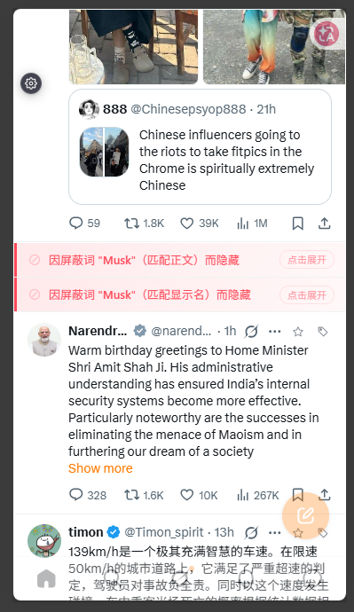
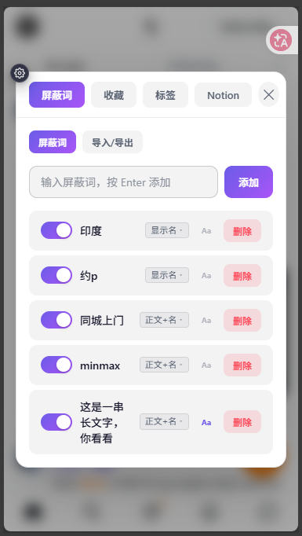
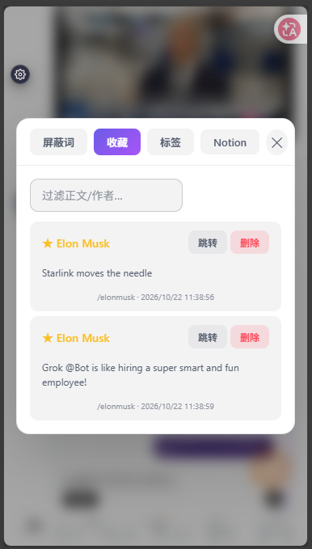
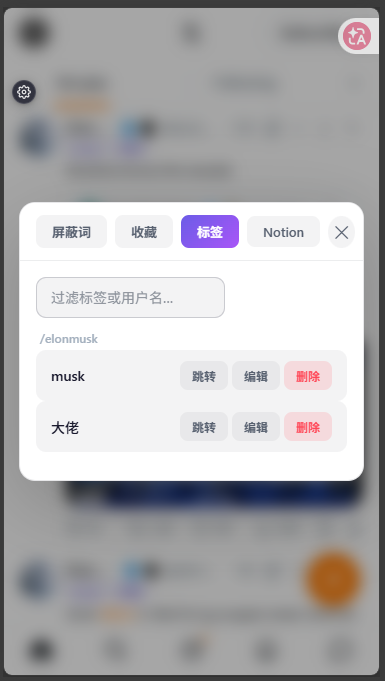
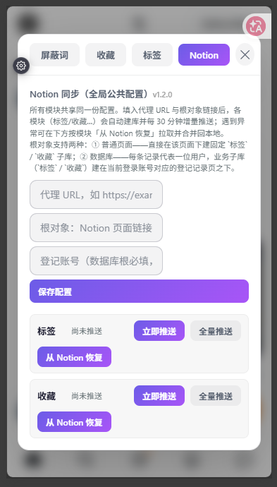

# x-manage

X（Twitter）内容管理增强：关键词屏蔽、推文收藏、标签管理，并可将数据同步到 Notion。
同一套 UI 以两种方式分发：**浏览器扩展（MV3）** 与 **油猴脚本（userscript）**。



## 功能

- **屏蔽词**：按关键词过滤时间线中的推文，支持导入/导出。
- **收藏**：在推文上收藏，支持增删与状态同步。
- **标签**：为推文/账号打标签。
- **Notion 同步**：把收藏与标签写入 Notion，也可从 Notion 恢复。
- **全局控制中心**：页面右下角的浮动按钮，点开后是统一的设置面板（屏蔽词 / 收藏 / 标签 / Notion）。

## 界面

控制中心是覆盖在 X 页面上的浮层，四个 tab 共用一份配置：

| 屏蔽词 | 收藏 |
| --- | --- |
|  |  |
| **标签** | **Notion** |
|  |  |

## 仓库结构

| 目录 | 说明 |
| --- | --- |
| `x-manage/` | 浏览器扩展宿主（Vite + `vite-plugin-web-extension`），产物 `dist/` |
| `x-manage-monkey/` | 油猴脚本宿主（`vite-plugin-monkey`），产物 `dist/x-manage-monkey.user.js` |
| `x-manage-share/` | 共享层：控制中心、浮动按钮、Toast、样式、Notion 客户端 |
| `x-manage-lib-block/` | 屏蔽词功能与设置面板 |
| `x-manage-lib-fav/` | 收藏功能与设置面板、Notion 同步 |
| `x-manage-lib-tag/` | 标签功能与设置面板、Notion 同步 |
| `x-manage-lib-xlink/` | 站内链接 iframe 预览（当前未在 content 中启用） |

## 构建

这些包并未在本目录单独声明 workspace，而是注册在外层 monorepo 根部的 `pnpm-workspace.yaml`（`x-manage/*`）。
因此**不要**在本目录直接跑 `pnpm build`，那会触发根部的 turbo 全仓构建。建议按包构建：

```bash
# 在本目录
pnpm --dir x-manage-share build
pnpm --dir x-manage build
pnpm --dir x-manage-monkey build
```

或在外层仓库根按包过滤：

```bash
pnpm --filter x-manage-share build
```

- 扩展产物：`x-manage/dist/`（在浏览器「加载已解压的扩展程序」中选择该目录）。
- 油猴产物：`x-manage-monkey/dist/x-manage-monkey.user.js`。
- 修改 `x-manage-share` 后需重新构建**宿主**（`x-manage` / `x-manage-monkey`），因为共享层是打包进宿主的。

## 浮动按钮（控制中心）

页面内唯一的入口按钮 `#x-manage-fab`，行为如下：

- **外观**：44×44 暗色毛玻璃药丸，圆角 14px，`backdrop-filter` 模糊。
- **静置半隐藏**：自动收起为 24×24 圆标（折叠间距：左侧 8px、右侧 20px，右侧留出滚动条余量，避免落在浏览器滚动条命中死区里）。
- **展开**：鼠标悬停或按下拖拽时展开为完整药丸；松开后约 300ms 自动收回。
- **拖拽停靠**：可拖动，松手自动吸附到最近的左/右边缘，纵向位置保留。
- **位置记忆**：停靠位置写入 `chrome.storage.local`，刷新后恢复上次的停靠侧与纵向位置。
  - 存储的是**展开态**坐标（`left` 为贴边展开时的位置），加载时再按当前视口吸附显示。
  - 挂载时的吸附只调整显示、不写存储，避免占位坐标覆盖已保存的位置。
- **点击**：折叠态点击先展开，展开态点击打开控制中心面板。

## Notion 同步

### 数据模型

采用「一个根数据库 + 每个账号一行登记 + 固定子数据库」的扁平结构：

```
根数据库（例如「twitter」）
└── 每个账号一行（Name = /handle，如 /yangw448531）
    ├── 收藏 子数据库
    └── 标签 子数据库
```

### 配置项

在控制中心的 Notion 页填写：

- `proxyUrl`：Notion 代理地址（形如 `https://example.com/api/notion`）。
- `rootPageUrl` / `rootPageId`：根数据库页面，填写页面链接即可，内部会解析出 ID。
- `登记账号`（可选）：写入登记的账号 handle；留空则自动嗅探当前登录账号，也可手动覆盖。

推送/恢复前会**自动保存当前表单**，无需先点「保存配置」。

### 推送语义

- **增量推送**：只推送游标之后的新增记录，成功后更新游标。
- **全量推送**：忽略游标，强制 upsert 全部本地记录；本地为空时提示「本地无记录可推送」。
- 操作期间按钮显示进行中文案与 spinner，其余按钮禁用，防止重复点击。
- 所有操作结果 Toast 带模块前缀，例如 `收藏：已全量推送 2 条`。
- 页面加载后会尝试自动增量推送，其后每 30 分钟执行一次。

## 本地存储键

| 键 | 内容 |
| --- | --- |
| `x_manage_block_words` | 屏蔽词列表 |
| `x_manage_filter_rule` | 过滤规则（大小写敏感等） |
| `x_manage_fab_position` | 浮动按钮停靠位置 `{ top, left }` |
| `x_manage_notion_setup` | Notion 配置 `{ proxyUrl, rootPageId, rootPageUrl?, accountHandle? }` |
| `x_manage_xlink_config` | 站内链接预览配置（预留） |

油猴版本使用 `GM_setValue` / `GM_getValue` 做等价存储。

## 备注

- 版本号统一由 `x-manage-share/src/version.ts` 的 `XMANAGE_VERSION` 提供，展示在 Notion 面板标题右侧。
- 上游 Notion 代理需自行部署并放行；扩展与油猴脚本分别需要在 manifest / `connect` 中白名单该域名。
